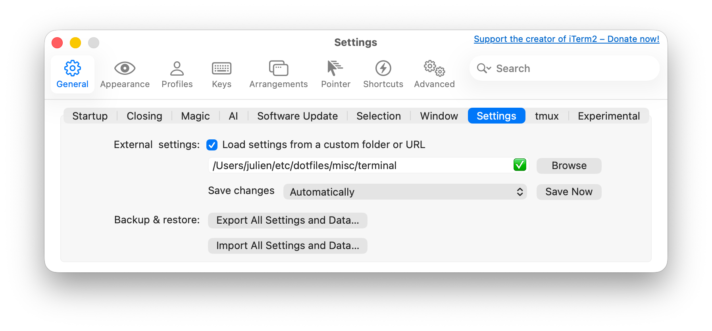

# Julien’s dotfiles


```
❯ ./dot.sh
Usage:
./dot.sh [--dry-run] [--dotfiles] [--brew] [--sublime] [--macos|--macos-export|--macos-diff] [--hostname <name>]

Options:
   -d | --dotfiles    Symlink dotfiles in home/ directory
   --brew             Install Homebrew, symlink Brewfile, run 'brew bundle install --global'
   --sublime          Symlink Sublime Text preferences
   --macos            Apply macOS defaults from macos/defaults.yaml
   --macos-export     Read current system values, rewrite macos/defaults.yaml
   --macos-diff       Show keys where the manifest and system disagree
   --hostname <name>  Set ComputerName, LocalHostName, and HostName (requires sudo)
   -n | --dry-run     Print what would be linked without touching the filesystem
```

### Homebrew + Brewfile

Brace yourself. Installs Homebrew if missing, links `etc/Brewfile` to
`~/.Brewfile` and runs `brew bundle install --global`.

```shell
./dot.sh --brew
```

### Shells: fish interactive, bash for login and agents

Fish is the interactive shell (started by iTerm), bash is the login shell
because fish isn't POSIX, and coding agents run bash. Both configs are kept in sync:

- `home/shell/env.sh` and `home/shell/aliases.sh` are sourced by **both**
  `home/bash_profile.sh` and `config/fish/config.fish`. Only plain
  `export NAME=value` / `alias name='value'` lines go there.
- PATH is set in each file with the same list (`path_add` mirrors `fish_add_path`).
- Reusable commands are scripts in `home/bin/` (linked to `~/.bin`), not fish
  functions, so every shell gets them. `git-*` scripts also work as `git <name>`.

```sh
echo /opt/homebrew/bin/bash | sudo tee -a /etc/shells
chsh -s /opt/homebrew/bin/bash
```

Fish prompt:

```shell
fisher install IlanCosman/tide@v6
fisher install franciscolourenco/done

tide configure --auto --style=Lean --prompt_colors='16 colors' --show_time='24-hour format' --lean_prompt_height='Two lines' --prompt_connection=Disconnected --prompt_spacing=Sparse --icons='Many icons' --transient=No
```

`z`/`j` jumps come from [zoxide](https://github.com/ajeetdsouza/zoxide) (Brewfile), set up in both shells.

Nerd Font (MesloLGS NF) is installed by the Brewfile.

### Link configuration

`./dot.sh --dotfiles` can be executed anytime. It also removes dangling
symlinks into this repo left behind by renamed or deleted files.

Configure iTerm to use `misc/terminal`.



### macOS defaults

System preferences (Finder, Dock, Trackpad, screensaver lock, menu bar clock,
…) are managed declaratively in `macos/defaults.yaml`. Every entry carries its
`defaults(1)` type so the same manifest can be both read and written.

Requires [`yq`](https://github.com/mikefarah/yq) (v4+): `brew install yq`.

```shell
./dot.sh --macos          # apply the manifest to this machine
./dot.sh --macos-diff     # show keys where the manifest and system disagree
./dot.sh --macos-export   # read current system values, rewrite the manifest
```

`macos/defaults.sh` is standalone — it can be run directly with
`./macos/defaults.sh {apply|export|diff}`.

`--macos-export` only refreshes keys that are **already listed** in the
manifest. To add a new setting, edit `defaults.yaml` by hand first, then
re-export to capture its current value. This avoids accidentally dumping
entire domains like `com.apple.dock` (which embeds machine-specific
`persistent-apps` binary blobs).

### 1password-cli (ssh-agent)

...

### TouchID for root password

Use TouchID to _sudo_ instead of password.
Source: https://davidwalsh.name/touch-sudo

```sh
# Open the sudo utility
sudo vi /etc/pam.d/sudo

# Add the following as the first line
auth sufficient pam_tid.so
```


```diff
# sudo: auth account password session
+ auth       sufficient     pam_tid.so
auth       sufficient     pam_smartcard.so
auth       required       pam_opendirectory.so
account    required       pam_permit.so
password   required       pam_deny.so
session    required       pam_permit.so
```


## Thanks to…

* [@mathiasbynens](https://github.com/mathiasbynens/dotfiles/) ([compare](https://github.com/mathiasbynens/dotfiles/compare/d6ca39a907123c0a7f874c500ba16cabb3156a63...master))
* [@paulmillr](https://github.com/paulmillr/dotfiles/) ([for vim config](https://github.com/paulmillr/vimrc/tree/5b472316d099fc1f6626ca790e81f6d021747c13))
* [@statico](https://github.com/statico/dotfiles/)
